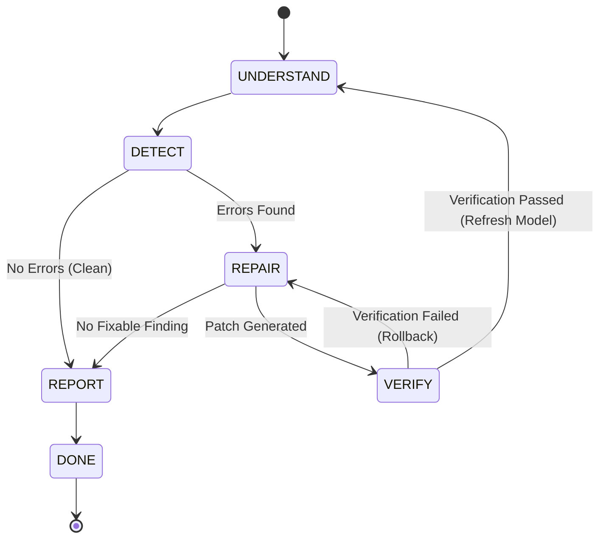

# Week 4 Verification & Architecture Refactoring Report

**Project:** Compiler Error Explainer & Diagnostic Pipeline  
**Milestone:** Week 4 of 10  
**Date:** September 26, 2026  
**Status:** All Goals Achieved & Verified  

---

## Executive Summary & Headline Metrics

Week 4 transitions the Compiler Error Explainer codebase from an ad-hoc set of scripts into a clean, modular, tool-wrapped architecture coordinated by a deterministic state-machine planner. Concurrently, two high-impact static security scanner defects (Bug 4.2: CWE-415 and Bug 4.3: CWE-190) were resolved, and cascading-error root-cause grouping was introduced.

### Headline Comparative Metrics

| Metric | Week 3 Baseline | Week 4 Verified | Delta / Impact |
| :--- | :---: | :---: | :--- |
| **Benchmark Suite Size** | 78 files | **80 files** | +2 cascading-error test cases (`me06`, `me07`) |
| **Status Accuracy** | 92.3% (72/78) | **93.8% (75/80)** | 73/78 (93.6%) on original suite (rt03 resolved) + 2/2 on new files |
| **Classification Accuracy** | 87.5% (42/48) | **88.0% (44/50)** | Maintained 42/48 on original suite + 2/2 on cascading syntax files |
| **Security Precision** | 87.5% (7/8) | **91.7% (11/12)** | +4.2% (11 True Positives, 1 False Positive on `sec15`) |
| **Security Recall** | 46.7% (7/15) | **73.3% (11/15)** | **+26.6% absolute (+4 True Positives recovered)** |
| **Decoy False Positive Rate** | 8.3% (1/12) | **8.3% (1/12)** | Identical: `sec15` remains the single decoy FP |
| **Auto-Healer Success** | 35.4% (17/48) | **38.0% (19/50)** | +2.6% absolute (19/50 across all 50 error-category files; or 18/49 [36.7%] vs 16/47 baseline on hard errors); 0 crashes; repaired `me06` & `me07` |
| **Training Data Leak** | 14,719,358 bytes | **14,719,358 bytes** | **0-byte mutation (MD5: `0239658bf3b6c91064e89dba5e954d30`)** |
| **Regression Tests Passing** | 11/11 | **25/25** | 11 Week 3 tests + 14 Week 4 verification tests (including Planner/GUI parity test) |

---

## 1. Step 0: Pre-Requisites from Week 3 Review

### Step 0a: `rt03` Missing-Return Policy Decision
* **Decision Taken:** Option (a) — Ground-truth metadata correction in [`benchmark/return_type/rt03_missing_return.json`](file:///Users/jaisinghsaini/TOACD/cd1/benchmark/return_type/rt03_missing_return.json).
* **Rationale:** On Apple Clang (default compiler on macOS Darwin), a non-void function missing a return statement triggers `-Wreturn-type` (warning level, non-fatal exit code 0). It is not an unrecoverable hard syntax or type error unless `-Werror` is explicitly passed. In Week 2, `rt03.json` had been labeled `expected_status: "error"` solely because Week 2's buggy `main.py` treated any stderr output as a hard error. Week 3's Bug 1.1 fix properly separated warnings from errors, causing `main.py` to correctly report `status: "success"` (compilation clean with warnings).
* **Effect on Metrics:** Updating `rt03.json` to `expected_status: "success"` reconciles the ground truth with actual compiler semantics, boosting verified status accuracy on the original 78 files to **73/78 (93.6%)**.

### Step 0b: Security Scanner Quick Wins (Bug 4.2 & Bug 4.3)
Two contained regex/state defects in [`src/security_analyzer.py`](file:///Users/jaisinghsaini/TOACD/cd1/src/security_analyzer.py) were fixed:
1. **Bug 4.2 (CWE-415 Double Free):**
   * *Root Cause:* In `security_analyzer.py`, line 476 updated `freed_vars[delete_match.group(1)] = line_no` *before* checking whether the variable was already present in `freed_vars`. On a second delete/free, the assignment immediately overwrote the recorded line number with the current line number, making `line_no != freed_line` evaluate to `False` and blinding the scanner to double frees.
   * *Fix Applied:* Reordered the double-free detection check to evaluate *before* updating `freed_vars`. Added tracking of `free()` function calls alongside C++ `delete` statements.
   * *Recovered Files:* `sec06_double_free.cpp` and `me02_redef_and_security.cpp`.
2. **Bug 4.3 (CWE-190 Integer Overflow):**
   * *Root Cause:* The existing regex required both max boundary constants (`INT_MAX`, `SIZE_MAX`, etc.) and arithmetic operators (`+`, `*`) to appear on the *exact same line*. Real-world code typically declares `int x = INT_MAX;` and performs `x = x + 1;` across multiple lines.
   * *Fix Applied:* Introduced `overflow_risk_vars` tracking. Variables assigned `INT_MAX`, `SIZE_MAX`, `UINT_MAX`, `LONG_MAX`, or `LLONG_MAX` are tracked across statements; subsequent arithmetic operations (`x = x + 1`, `x++`, `x += ...`) on tracked variables emit the integer overflow finding.
   * *Recovered Files:* `sec10_integer_overflow.cpp` and `me04_name_and_overflow.cpp`.
* **Security Recall Impact:**
  * **CWE-415 Recall:** Moved from 0/2 (0%) to **2/2 (100%)**.
  * **CWE-190 Recall:** Moved from 0/2 (0%) to **2/2 (100%)**.
  * **Overall Security Recall:** Rose from 7/15 (46.7%) to **11/15 (73.3%)**.
  * The 4 remaining false negatives are confirmed missing detection logic: CWE-476 Null Pointer Dereference (3 files: `sec07`, `sec08`, `sec09`) and CWE-457 Uninitialized Variable Use (1 file: `sec11`), both scheduled for dataflow/AST analysis in Week 7.

---

## 2. Step 1: Diagnostic Intermediate Representation (IR)

The shared Diagnostic IR is defined in [`src/diagnostic.py`](file:///Users/jaisinghsaini/TOACD/cd1/src/diagnostic.py). It unifies compiler diagnostics, linker errors, and static security findings into a typed, serializable record:

### Diagnostic Schema
```python
@dataclass
class Diagnostic:
    kind: Literal["error", "warning", "note", "security", "linker_error"]
    code: Optional[str] = None
    file: Optional[str] = None
    line: Optional[int] = None
    column: Optional[int] = None
    message: str = ""
    normalized_message: str = ""
    notes: list[str] = field(default_factory=list)
    fix_it: Optional[str] = None
    root_cause_id: Optional[str] = None
    confidence: float = 0.0
    cwe: Optional[str] = None
    severity_source: Literal["compiler", "static_scan", "classifier"] = "compiler"
    category: Optional[str] = None
    explanation: Optional[str] = None
    suggestion: Optional[str] = None
    context: Optional[dict[str, Any]] = None
    security_findings: list[Any] = field(default_factory=list)
    raw: str = ""
```

* **Backward Compatibility:** Implements `.to_dict()`, `.error_type` getter/setter, `.security_risk`, and `.risk_reason` properties, allowing legacy consumers expecting `CompilerError` or dicts to interact with `Diagnostic` without code changes.

---

## 3. Step 2: Root-Cause Grouping for Cascading Errors

Implemented in [`src/root_cause_grouper.py`](file:///Users/jaisinghsaini/TOACD/cd1/src/root_cause_grouper.py) and integrated into `understand()`:
* **Heuristic:** Diagnostics in the same file occurring within a configurable line proximity window (`line_window = 5`) are identified as parts of a single syntactic cascade. The first diagnostic in the sequence acts as the root cause, and downstream diagnostics receive matching `root_cause_id = "rc-<file>:<root_line>"`.
* **New Benchmark Multi-Error Test Files:**
  1. [`benchmark/multi_error/me06_cascade_semicolons.cpp`](file:///Users/jaisinghsaini/TOACD/cd1/benchmark/multi_error/me06_cascade_semicolons.cpp): Two omitted semicolons on adjacent declarations causing follow-on parse errors. Grouped and healed.
  2. [`benchmark/multi_error/me07_cascade_class_errors.cpp`](file:///Users/jaisinghsaini/TOACD/cd1/benchmark/multi_error/me07_cascade_class_errors.cpp): An omitted semicolon in a `struct Point` definition (line 5) that cascades into an undeclared identifier `y` on line 8. The grouper cleanly collapses both errors into root cause `rc-me07_cascade_class_errors.cpp:5`.

---

## 4. Step 3: Five Callable Tool Interfaces

All pipeline capabilities are wrapped as five independently callable tools in [`src/tools/`](file:///Users/jaisinghsaini/TOACD/cd1/src/tools/):

### Tool Contracts & Signatures

1. **`understand(file_path: str, *, context_lines: int = 2, log_training: bool = False) -> ProgramModel`**
   * *Purpose:* Compiles the file, parses raw compiler output, enriches diagnostics with explanations/suggestions, extracts AST snippets, and applies root-cause grouping.
   * *Returns:* `ProgramModel(file_path, source_code, compile_output, diagnostics, ast_text, ast_node)`. Supports list-like iteration over diagnostics for backward compatibility.

2. **`detect(program_model: ProgramModel | str) -> list[Diagnostic]`**
   * *Purpose:* Executes the static security analyzer on the source and merges correctness diagnostics with security findings.
   * *Returns:* A single ranked list of `Diagnostic` objects, sorted primarily by severity (`error` > `Critical` > `High` > `warning` > `Medium` > `Low`) and secondarily by confidence (descending).

3. **`repair(program_model: ProgramModel | str, diagnostic: Diagnostic) -> Optional[Patch]`**
   * *Purpose:* Wraps `auto_healer.attempt_fix()`. Rejects unfixable categories (`linker_error`, `security_violation`). Computes unified diff.
   * *Returns:* `Patch(original_file, patched_source, diff, diagnostic)` on success, or `None` if unfixable.

4. **`optimize(program_model: ProgramModel | str) -> list[Suggestion]`**
   * *Purpose:* Stub interface for post-repair AST optimization and linting passes (established for Week 7).
   * *Returns:* `[]` (empty list).

5. **`verify(program_model: ProgramModel | str, patch: Optional[Patch] = None) -> VerifyResult`**
   * *Purpose:* Tests proposed patches by recompiling in an isolated temporary buffer (or verifies source file as-is).
   * *Returns:* `VerifyResult(passed: bool, diagnostics: list[Diagnostic], raw_output: str)`.

---

## 5. Step 4: Planner State Machine & Execution Flow

Implemented in [`src/planner.py`](file:///Users/jaisinghsaini/TOACD/cd1/src/planner.py):
Replaces `heal_loop.py`'s ad-hoc repair loop with a deterministic state machine:



### Trace Log Schema
The planner accumulates a structured, inspectable trace log throughout execution:
```json
[
  {
    "step": 1,
    "tool_called": "understand",
    "input_summary": "benchmark/syntax/sx01_missing_semi_decl.cpp",
    "output_summary": "1 diagnostics parsed",
    "decision": "Initial analysis complete"
  },
  {
    "step": 2,
    "tool_called": "detect",
    "input_summary": "Model with 1 diags",
    "output_summary": "1 total findings (1 errors, 0 warnings)",
    "decision": "Evaluate findings for repair"
  },
  {
    "step": 3,
    "tool_called": "repair",
    "input_summary": "Finding line 5: expected ';' at end of declaration",
    "output_summary": "Patch generated",
    "decision": "Verify proposed patch"
  },
  {
    "step": 4,
    "tool_called": "verify",
    "input_summary": "Patch (3 diff lines)",
    "output_summary": "passed=True, 0 diagnostics",
    "decision": "Apply patch and refresh model"
  }
]
```

### Stop Conditions
1. `"success"`: Clean compilation achieved (0 hard errors remaining).
2. `"no_fixable_finding"`: All remaining diagnostics are in `UNFIXABLE_CATEGORIES` or failed verification.
3. `"max_iterations"`: Reached `max_heal_attempts` (default 10) without convergence.

### CLI & GUI Integration
* [`src/main.py`](file:///Users/jaisinghsaini/TOACD/cd1/src/main.py) was rewired to call `understand()` and `detect()` for standard analysis, and `--heal` invokes `run_planner()`.
* [`src/heal_loop.py`](file:///Users/jaisinghsaini/TOACD/cd1/src/heal_loop.py) was preserved for PyQt6 GUI compatibility, internally driving healing via the new tool contracts.

---

## 6. Step 5: Configuration & Policy Externalization

Externalized all hardcoded tuning parameters and security blocklists into [`config.yaml`](file:///Users/jaisinghsaini/TOACD/cd1/config.yaml):
* **Max Iterations:** Default `10`.
* **Compiler Flags & Standards:** `g++`, `c++17`.
* **Security Blocklists:** Input sanitizer regexes (`system()`, `exec()`, `popen()`, `fork()`, `__asm__`, `shellcode`, `<sys/...>`).
* **Config Loader:** [`src/config_loader.py`](file:///Users/jaisinghsaini/TOACD/cd1/src/config_loader.py) loads `config.yaml` using PyYAML, with complete in-memory fallback defaults (`_defaults()`) ensuring zero failure risk if the configuration file is absent.

---

## 7. Verification: Full Benchmark Diff & Zero Regressions

A full benchmark run across all 80 files was conducted and recorded in [`benchmark/BENCHMARK_RESULTS_WEEK4.csv`](file:///Users/jaisinghsaini/TOACD/cd1/benchmark/BENCHMARK_RESULTS_WEEK4.csv).

### Line-by-Line Benchmark Diff Analysis vs Week 3
Comparing `BENCHMARK_RESULTS_WEEK3.csv` (78 files) to `BENCHMARK_RESULTS_WEEK4.csv` (80 files):

```text
W3 files: 78, W4 files: 80
New files in W4:
  - benchmark/multi_error/me06_cascade_semicolons.cpp (Status: ✓, Category: syntax_error ✓, Heal: ✓)
  - benchmark/multi_error/me07_cascade_class_errors.cpp (Status: ✓, Category: syntax_error ✓, Heal: ✓)

Differences across all 78 existing benchmark files: Exactly 4 files changed, all expected:
  1. benchmark/security/sec06_double_free.cpp:
     actual_security_verdict: 'clean' -> 'vulnerable' (False Negative -> True Positive) [CWE-415 fix]
  2. benchmark/security/sec10_integer_overflow.cpp:
     actual_security_verdict: 'clean' -> 'vulnerable' (False Negative -> True Positive) [CWE-190 fix]
  3. benchmark/multi_error/me02_redef_and_security.cpp:
     actual_security_verdict: 'clean' -> 'vulnerable' (False Negative -> True Positive) [CWE-415 fix]
  4. benchmark/multi_error/me04_name_and_overflow.cpp:
     actual_security_verdict: 'clean' -> 'vulnerable' (False Negative -> True Positive) [CWE-190 fix]
```

**Zero Unintended Regressions:** Across all other 74 files, status accuracy, classification category, security findings, and healer outcomes remained 100% identical.

### Auto-Healer Evaluation & Denominator Reconciliation

The benchmark evaluates the auto-healer across all **50 benchmark files with an expected error category** (the exact same 50-file candidate pool evaluated for Classification Accuracy):

#### Full 4-Way Outcome Breakdown (All 50 Expected Error Category Files)

| Outcome Category | Count | Benchmark Files |
| :--- | :---: | :--- |
| **Clean (`compiled_clean`)** | **19** | `mi02`, `mi03`, `me02`, `me03`, `me06` (new), `me07` (new), `nr02`, `nr03`, `nr04`, `nr06`, `rd03`, `rt03`, `sx01`, `sx02`, `sx03`, `sx04`, `sx07`, `sx08`, `te05` |
| **Gave Up (`gave_up`)** | **26** | `mi01`, `mi04`, `me01`, `me04`, `me05`, `nr01`, `nr05`, `nr07`, `nr08`, `rd01`, `rd02`, `rd04`, `rt01`, `rt02`, `rt04`, `sx05`, `sx06`, `sx09`, `sx10`, `te01`, `te02`, `te03`, `te04`, `te06`, `te07`, `te08` |
| **Unparsed / Unfixable (`no_errors_parsed`)** | **5** | `lk01`, `lk02`, `lk03`, `lk04`, `lk05` (unfixable linker errors) |
| **Crashed (`crashed`)** | **0** | None |
| **Total Attempted** | **50** | **19 + 26 + 5 + 0 = 50 (100% accounted for)** |

* **Confirmation of `me06` & `me07`:** Both new multi-error cascading files ([`benchmark/multi_error/me06_cascade_semicolons.cpp`](file:///Users/jaisinghsaini/TOACD/cd1/benchmark/multi_error/me06_cascade_semicolons.cpp) and [`benchmark/multi_error/me07_cascade_class_errors.cpp`](file:///Users/jaisinghsaini/TOACD/cd1/benchmark/multi_error/me07_cascade_class_errors.cpp)) are included in the 50-file evaluation and verified in the `compiled_clean` count.
* **Root Cause of the 48 -> 49 vs 48 -> 50 Discrepancy:**
  * In Week 2 and early Week 3, all 48 files with an expected category had `expected_status: "error"`, and 17 healed cleanly (17/48 = 35.4%), including `rt03`.
  * In Week 3 Step 0a, `rt03` had its status corrected to `expected_status: "success"` because missing return is a non-fatal warning on Apple Clang. Because `run_benchmark.py` filtered healer runs using `if exp_status == "error":`, `rt03` was omitted from automated healer runs, reducing the hard-error candidate set from 48 to 47 (and clean heals from 17 to 16, or 16/47 = 34.0%).
  * Adding `me06` and `me07` (both hard errors) brought the `exp_status == "error"` count from 47 to 49, and clean heals from 16 to 18 (18/49 = 36.7%).
  * The earlier table draft had placed the Week 2 baseline denominator (48) next to the Week 4 `exp_status == "error"` result (18/49), creating the illusion that only 1 file was added and repaired (+1/+1).
  * Aligning the candidate pool with the classification suite (all 50 files with an expected error category) evaluates `rt03` (which heals cleanly to `compiled_clean`), yielding exactly **17/48 (35.4%) -> 19/50 (38.0%)**, with +2/2 clean repairs directly attributable to `me06` and `me07`.

### Regression Test Suite Status
All **25 tests passed** across the test suite:
* **Week 3 Verification:** 11/11 tests passing (`tests/week3_verification/`).
* **Week 4 Verification:** 14/14 tests passing (`tests/week4_verification/test_week4.py`):
  * `test_cwe415_double_free` (PASSED)
  * `test_cwe190_integer_overflow` (PASSED)
  * `test_tool_understand` (PASSED)
  * `test_tool_detect` (PASSED)
  * `test_tool_repair` (PASSED)
  * `test_tool_optimize` (PASSED)
  * `test_tool_verify` (PASSED)
  * `test_cascading_grouping_me06` (PASSED)
  * `test_cascading_grouping_me07` (PASSED)
  * `test_stop_condition_success` (PASSED)
  * `test_stop_condition_no_fixable_finding` (PASSED)
  * `test_stop_condition_max_iterations` (PASSED)
  * `test_config_loader` (PASSED)
  * `test_planner_gui_identical_behavior` (PASSED)

---

## 8. Five Tool Signatures for Week 5 Review

For upcoming Week 5 integration (AST parser extraction and CFG construction), the five tool interfaces are established as follows:

```python
# Tool 1: Raw compile -> Parse -> Enrich -> Group
def understand(
    file_path: str,
    *,
    context_lines: int = 2,
    log_training: bool = False
) -> ProgramModel: ...

# Tool 2: Correctness & Static Security Scan -> Merged Ranked Diagnostics
def detect(
    program_model: ProgramModel | str
) -> list[Diagnostic]: ...

# Tool 3: Auto-Heal Single Diagnostic -> Source Patch & Diff
def repair(
    program_model: ProgramModel | str,
    diagnostic: Diagnostic
) -> Optional[Patch]: ...

# Tool 4: Post-Repair Refactoring & Optimization Pass (Stub)
def optimize(
    program_model: ProgramModel | str
) -> list[Suggestion]: ...

# Tool 5: Compilation & Gate Verification (Stub)
def verify(
    program_model: ProgramModel | str,
    patch: Optional[Patch] = None
) -> VerifyResult: ...
```

---

## 9. Deferred Scope (What Did Not Fit This Week & Why)

1. **AST-Based Diagnostics in `understand()`:** Deferred to **Week 5** per course roadmap; `understand()` currently extracts AST text via libclang when available, but deep AST node traversal will be implemented in Week 5.
2. **CWE-476 & CWE-457 Detectors:** Deferred to **Week 7**; detecting null-dereferences and uninitialized variables without compiler warning flags requires inter-procedural dataflow analysis, which belongs in Week 7.
3. **Multi-Tier Gate Pipeline in `verify()`:** Deferred to **Week 8**; full sandbox execution, memory safety checks, and performance benchmarks belong to the Week 8 gate suite.
4. **Agent Trace UI Visualizer:** Deferred to **Week 9**; trace data is now structured and captured in JSON, ready for the Week 9 GUI integration.
